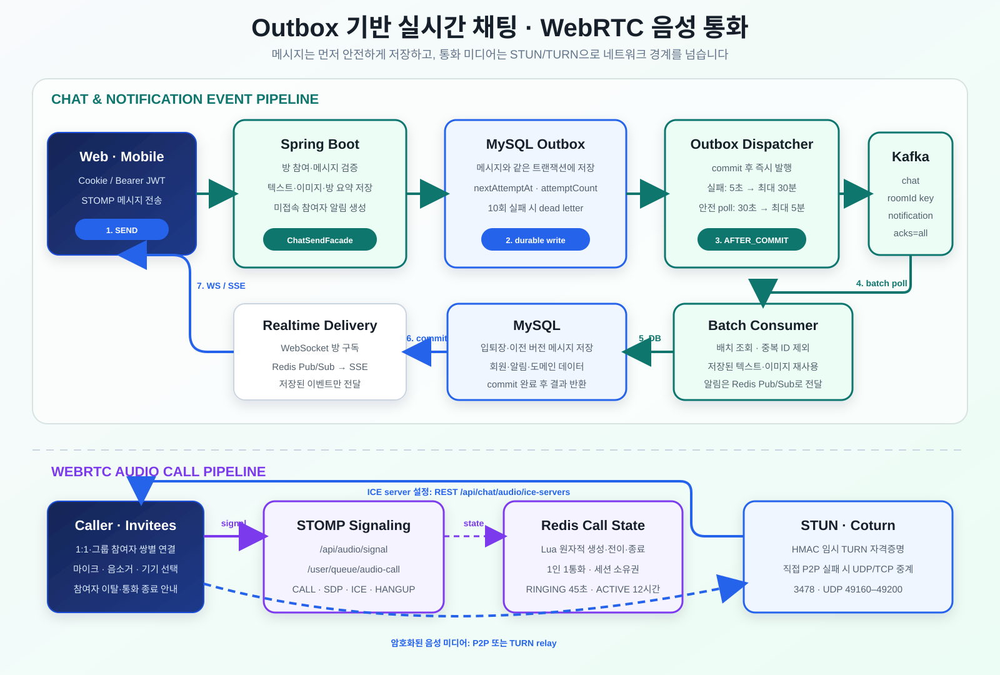

# Study Backend Project

Spring Boot 3.0.5와 Java 17로 구현한 웹·모바일 커뮤니티 서비스입니다.

소셜 피드, 개인 기록과 할 일, 실시간 채팅·알림, WebRTC 1:1·그룹 음성 통화, 계좌 상품, 신고·제재·상소와 관리자 운영 기능을 제공합니다. MySQL outbox, Kafka, Redis, WebSocket, SSE, Coturn, AWS S3를 사용합니다.

[운영 서비스](https://www.kwanwoo.site) · [웹 포트폴리오](https://www.kwanwoo.site/portfolio)

## 목차

- [프로젝트 핵심](#프로젝트-핵심)
- [시스템 아키텍처](#시스템-아키텍처)
- [채팅 및 알림 처리 흐름](#채팅-및-알림-처리-흐름)
- [음성 통화 흐름](#음성-통화-흐름)
- [주요 기능](#주요-기능)
- [웹과 모바일 인증](#웹과-모바일-인증)
- [기술 스택](#기술-스택)
- [실행 방법](#실행-방법)
- [TURN 배포 설정](#turn-배포-설정)
- [테스트](#테스트)
- [주요 경로](#주요-경로)
- [운영 및 장애 대응](#운영-및-장애-대응)

## 프로젝트 핵심

- Thymeleaf 웹과 iOS/Android 앱이 같은 도메인 API를 사용합니다.
- 웹은 `HttpOnly` Cookie JWT, 모바일은 Bearer JWT와 Refresh Token 회전 방식을 사용합니다.
- 채팅·알림 이벤트는 Kafka 발행 전에 MySQL outbox에 기록해 Kafka 장애 시에도 복구할 수 있습니다.
- 텍스트 채팅은 메시지와 outbox를 같은 MySQL 트랜잭션에 저장합니다. Kafka의 `roomId` key와 배치 소비를 거쳐 WebSocket으로 전달하며, 재전송과 재접속 복구는 메시지 ID를 기준으로 처리합니다.
- 알림은 Kafka Consumer가 Redis Pub/Sub에 전달하고 각 서버 인스턴스가 SSE 연결로 전송합니다.
- 1:1·그룹 음성 통화는 STOMP로 시그널링하고 참여자 간 WebRTC 미디어는 P2P 또는 Coturn으로 전달합니다.
- Redis Lua script로 통화 생성·상태 전이·종료를 원자적으로 처리합니다.
- 관리자 화면에서 시스템 자원, outbox 대기/dead letter, 장애 IP와 반복 횟수, 통화 강제 종료를 관리합니다.

## 시스템 아키텍처



```text
Web / iOS / Android
  ├─ REST / Thymeleaf
  ├─ STOMP WebSocket
  └─ SSE
          │
          ▼
Spring Boot Application
  ├─ MySQL : 도메인 데이터, JWT Refresh Token, Kafka outbox
  ├─ Redis : 접속·통화 상태, 캐시, 메모 초안, 알림 Pub/Sub
  ├─ Kafka : 채팅·알림 이벤트 전달 및 채팅 batch 소비
  ├─ AWS S3 : 게시글·채팅·프로필·컬렉션·다이어리 이미지
  └─ Coturn : WebRTC 직접 연결 실패 시 음성 미디어 중계
```

### 저장소별 책임

| 구성 요소 | 책임 |
| --- | --- |
| MySQL | 회원, 콘텐츠, 개인 기록, 채팅, 알림, 신고·제재, 계좌와 outbox 영속화 |
| Redis | 온라인·채팅방 접속 상태, 회원 캐시, 통화 상태/TTL, 메모 초안, 알림 Pub/Sub |
| Kafka | 채팅·알림 이벤트 비동기 전달, `roomId` key로 같은 방의 이벤트를 같은 파티션에 배치 |
| AWS S3 | 서비스 이미지 저장 |
| Coturn | 서로 다른 NAT/방화벽 환경에서 WebRTC 미디어 relay |

서버 코드는 `src/main/java/spring/study` 아래 도메인별 패키지에 있습니다. HTTP 요청은 대체로 Controller → Facade → Service → Repository 순서로 처리합니다. `src/main/resources` 아래의 `templates`와 `static/js`에 Thymeleaf 화면과 JavaScript가 있습니다.

## 채팅 및 알림 처리 흐름

### 텍스트 메시지 저장과 전달

```text
STOMP /api/chat/message/send
  └─ ChatSendFacade (TALK)
       ├─ 방 참여 권한·메시지 길이·ID·금칙어 검증
       ├─ 한 MySQL 트랜잭션에서 메시지, 방 요약, outbox와 알림 저장
       └─ 커밋 후 디스패치 요청 → Kafka topic (key = roomId)
            └─ MessageConsumer → ChatMessageService.saveBatch
                 └─ 커밋된 메시지를 /sub/chat/room/{roomId}로 전달
```

- 브라우저는 텍스트와 이미지를 같은 UUID로 다시 보내고 `GET /api/chat/message/{id}/receipt`로 MySQL 저장 여부를 확인할 수 있습니다. 재접속 시 `GET /api/chat/missed`가 마지막 메시지 이후 기록을 시각·ID 순서로 반환합니다.
- Producer는 `acks=all`과 멱등 발행을 사용합니다. 소비 배치 크기는 `chat.kafka.batch.max-records`로 지정합니다.
- Consumer는 저장된 텍스트·이미지 메시지를 재사용하고, DB에 없는 입퇴장 이벤트와 이전 버전의 메시지는 배치로 저장합니다. 같은 배치의 중복 ID와 수정·삭제된 메시지의 오래된 생성 이벤트는 걸러냅니다.
- Consumer 실패는 재시도 후 Kafka DLT에 보관하며 관리자 `/admin/kafka`에서 지연 확인·실패 재발행을 지원합니다.
- 채팅 ID와 알림 이벤트 ID로 실시간 중복 전달을 줄입니다. 알림 소비자는 DB에서 최신 상태를 확인한 뒤 전달합니다.

토픽 생성 정책, 재발행 상태, 중복 방지의 범위와 배포 설정은 [Kafka 운영 문서](docs/kafka-operations.md)를 참고하세요.

메시지 전송은 `/ws/chat`의 STOMP destination을 사용합니다. REST API는 방·메시지 조회, 저장 확인, 이미지 업로드, 수정·삭제에 사용합니다.

### 채팅방 권한과 이미지 전송

- 웹은 `PUT /api/chat/rooms/{roomId}/membership`으로 입장을 확인하고 구독을 시작합니다. `DELETE`는 해당 방에서 나갑니다. STOMP 연결은 인증이 필요하며, 방 구독과 전달 시점에 현재 참여 권한을 확인합니다.
- 이미지 업로드는 `POST /api/chat/sendImage?roomId={roomId}`에서 로그인 회원과 방에 임시 첨부를 연결합니다. 이전 클라이언트가 방 ID를 생략하면 업로드한 회원만 자신이 참여 중인 방에서 사진을 사용할 수 있습니다.
- STOMP 이미지 메시지는 업로드에서 받은 ID를 사용합니다. 서버가 저장된 이미지 URL을 사용해 메시지와 outbox를 함께 저장하므로 같은 ID를 다시 보내도 첨부가 한 번만 반영됩니다.
- 미완료 업로드는 1시간 뒤에, 업로드 완료 후 전송하지 않은 첨부는 24시간 뒤에 정리 대상이 됩니다. S3 삭제가 실패하면 다시 시도합니다.

### Kafka outbox 복구 정책

```text
이벤트 생성
  └─ MySQL outbox 저장
       ├─ commit 후 즉시 Kafka 발행
       └─ 실패 시 nextAttemptAt 기록
            ├─ 5초부터 최대 30분까지 지수 백오프
            ├─ 10회 실패 시 dead letter
            └─ 누락 복구용 안전 poll: 30초 → 1분 → 2분 → 4분 → 최대 5분
```

- Dispatcher는 한 번에 최대 100건의 발행 가능한 이벤트만 잠금 조회합니다.
- 이벤트가 생성되면 1개 scheduler thread에서 즉시 발행하므로 상시 1초 polling을 하지 않습니다.
- 작업이 없을수록 안전 poll 간격을 늘리고, 작업이 발견되면 초기 간격으로 돌아갑니다.
- Kafka 장애 중에는 다음 재시도 시각까지 전역 발행을 잠시 막아 반복 연결 비용을 줄입니다.
- 성공한 outbox 행은 삭제하고, dead letter는 관리자 대시보드의 queue 지표로 확인합니다.

안전 조회 주기는 다음 설정으로 조정할 수 있습니다.

```properties
kafka.outbox.safety-poll-initial-ms=30000
kafka.outbox.safety-poll-max-ms=300000
```

### 알림

```text
도메인 트랜잭션
  └─ Notification + KafkaOutboxEvent 저장
       └─ commit 후 Kafka topic2 발행
            └─ Consumer → Redis Pub/Sub notification-events
                 └─ 각 애플리케이션 인스턴스 → 사용자 SSE 연결
```

알림 저장과 outbox 저장을 같은 트랜잭션에 포함하며, 읽지 않은 개수·그룹별 조회·전체 읽음·개별 읽음 기능을 제공합니다. 채팅, 좋아요, 신고/관리자, 음성 통화 등의 알림 그룹을 지원합니다.

## 음성 통화 흐름

```text
Caller / Invitees
  ├─ STOMP /api/audio/signal
  │    └─ Spring Boot → /user/queue/audio-call
  │         └─ CALL / ACCEPT / REJECT / OFFER / ANSWER / ICE_CANDIDATE / HANGUP
  ├─ Redis AudioCallStateStore
  │    └─ 초대·수락·이탈 상태와 참여 세션 관리
  └─ WebRTC media
       ├─ 참여자 쌍별로 STUN을 통한 P2P 연결 시도
       └─ 실패하면 Coturn UDP/TCP relay
```

- 참여자가 2명 이상인 채팅방에서 통화를 시작할 수 있습니다. 통화 수신을 허용하고 다른 통화에 참여 중이지 않은 방 멤버를 초대합니다.
- `RINGING` 상태 TTL은 45초이며, 통화 중 상태 TTL은 12시간입니다.
- Redis Lua가 참여자별 키와 통화 상태를 원자적으로 갱신해 한 회원이 한 통화에만 참여하도록 합니다.
- 참여 세션에서 보낸 SDP·ICE는 지정된 상대 참여자에게 전달합니다.
- 통화 중 `KEEP_ALIVE`로 TTL을 갱신합니다. 연결이 끊기면 남은 참여자에게 이탈 또는 통화 종료를 알립니다.
- 수신자가 다른 화면에 있어도 실시간 알림과 `GET /api/chat/audio/incoming`으로 수신 통화를 복원할 수 있습니다.
- 관리자는 `DELETE /api/admin/chat/audio-call/{callId}`로 비정상 통화를 강제 종료할 수 있습니다.
- `GET /api/chat/audio/ice-servers`는 로그인 회원에게만 만료 시간이 있는 HMAC TURN 자격증명을 발급합니다.
- 음성 데이터는 Spring Boot나 Kafka에 저장하지 않으며 WebRTC P2P 또는 TURN relay로만 흐릅니다.

## 주요 기능

### 회원 및 인증

- 회원가입, 로그인, 로그아웃, 회원 검색과 프로필
- Google/Naver OAuth2 로그인
- 웹 `HttpOnly` JWT Cookie와 모바일 Bearer JWT
- Access Token 갱신 시 Refresh Token 회전 및 이전 token 폐기
- 활성 Refresh Token의 `jti`와 만료 시각을 MySQL에 저장
- 메일 인증을 거친 비밀번호 변경
- 휴대폰 번호, 프로필 공개 범위 변경과 회원 탈퇴
- 팔로우/언팔로우, 팔로잉·팔로워 조회

### 게시글, 관계와 기록

- 가입 전 첫 화면에서 피드·채팅·할 일의 예시를 볼 수 있는 체험
- 게시글 작성·조회·수정·삭제와 조회수
- 개인 게시글 북마크와 저장함
- AWS S3 이미지 업로드 및 정리 작업
- 좋아요 API와 좋아요 사용자 모달
- 댓글·대댓글 작성·수정·삭제와 전체 댓글 모달
- 개인 컬렉션 저장
- 이미지 다이어리 작성·검색·수정·삭제

### 개인 메모

- 일반 회원과 관리자 모두 본인 메모만 작성·조회·수정·삭제 (`/memos`)
- 1초 디바운스 Redis 임시 저장, 10초 유휴 또는 최대 60초 후 DB 반영 대상 처리
- 고정·색상 즉시 반영, 수동 DB 저장, 버전 충돌·응답 유실·장애 재시도 처리
- 배포 전 Redis 영속화/삭제 정책과 DB 변경 사항은 [개인 메모 운영 안내](docs/memo-service.md) 참고

### 할 일과 주간 회고

- 개인 할 일 작성·수정, 완료 처리, 마감일 설정과 기한 필터
- 주간 회고에서 그 주에 완료한 할 일과 작성한 다이어리 조회. [할 일 화면과 API](docs/todo-service.md)

### 채팅과 알림

- 그룹·1:1 채팅방 생성, 방 목록과 이전 메시지 조회, 재접속 후 누락 메시지 복구
- STOMP 메시지 전송, 동일 ID로 텍스트 재전송과 저장 확인
- 메시지 인용, 투표, 이미지, 수정, 나에게/모두에게 삭제
- Redis 기반 채팅방 접속·읽음 상태
- MySQL outbox, Kafka 배치 소비와 WebSocket 전달
- SSE 실시간 알림, 읽지 않은 개수, 그룹별 조회와 읽음 처리
- 1:1·그룹 WebRTC 음성 통화, 수신 알림, 음소거·입출력 장치 선택과 강제 종료

### 신고, 제재, 상소와 관리자

- 게시글·댓글·회원 등 대상 신고와 중복 신고 방지
- 신고 처리 상태, 관리자 메모, 경고·일시정지·차단 제재 이력
- 접수 대기 중인 본인 신고 취소
- 회원의 본인 제재 조회와 상소 제출, 관리자의 상태별 상소 조회
- 금칙어 신청·검토·승인과 위험도 누적 정책
- 온라인 회원, 신규 회원, 신규 게시글, 최근 활성 채팅 지표
- CPU, 메모리, 디스크, JVM, 접속, outbox/dead letter, 이미지 정리 queue 표시
- 서버 장애의 요청 경로·HTTP method·IP·예외·반복 횟수 저장 및 확인 처리

### 계좌

- 입출금, 정기예금, 적금 계좌 생성
- 계좌 입금·이체·이름 변경과 거래 내역
- 거래 취소 시 소유자·상태·기간을 검증하고 반대 거래 생성
- 예금·적금 금리, 만기, 누적 예상 이자 표시
- 적금 월 자동이체와 잔액 부족 알림
- 예금·적금 해지 금액 미리보기와 지정 계좌로 원금·이자 정산

## 웹과 모바일 인증

서버를 웹용과 앱용으로 나누지 않습니다. 같은 Spring Security filter와 도메인 API를 사용하되 token 전달 방식만 구분합니다.

| 클라이언트 | Access Token | Refresh Token | 로그인 API |
| --- | --- | --- | --- |
| Web | `HttpOnly` Cookie | `HttpOnly` Cookie + MySQL jti | `PATCH /api/member/login`, OAuth2 redirect |
| Mobile | `Authorization: Bearer ...` | 응답 body + MySQL jti | `/api/mobile/auth/login`, `/refresh`, `/logout` |

웹 재로그인(일반 로그인·OAuth2)은 현재 브라우저가 보낸 Refresh Token만 새 토큰으로 교체하며 다른 기기의 토큰을 유지합니다. 로그인·로그아웃 요청 자체가 토큰 발급과 폐기를 처리합니다. 일반 요청에서 Access Token을 갱신할 때 Refresh Token 만료가 하루 이내면 교체합니다. 웹과 모바일 모두 기존 토큰 폐기와 교체 토큰 저장을 한 DB 트랜잭션으로 처리합니다.

모바일 OAuth는 `/api/mobile/auth/oauth/{provider}`로 시작하고 성공 후 일회용 code를 `/api/mobile/auth/oauth/exchange`에서 앱 token으로 교환합니다. WebSocket도 별도 모바일 서버가 필요하지 않으며 인증된 연결에서 동일한 `/ws/chat` endpoint와 STOMP destination을 사용할 수 있습니다.

## 기술 스택

### Backend

- Java 17
- Spring Boot 3.0.5
- Spring MVC, Validation, AOP, Thymeleaf
- Spring Security, OAuth2 Client, JWT, BCrypt
- Spring Data JPA, Hibernate JDBC batch
- Spring WebSocket/STOMP, SockJS, SSE
- Spring Kafka

### Data, realtime 및 storage

- MySQL 8.0
- Redis 7.2
- Kafka, Zookeeper
- WebRTC, STUN, Coturn
- AWS S3
- H2 test runtime

### Infra 및 test

- Docker, Docker Compose
- Gradle
- AWS EC2, Load Balancer
- JUnit 5, Spring Boot Test, Spring Security Test, Spring Kafka Test
- JavaScript/template regression test

## 실행 방법

### 사전 준비

- 빌드에는 JDK 17과 저장소의 Gradle Wrapper를 사용합니다. `build`에 포함된 JavaScript 테스트에는 Node.js 22.13 이상이 필요합니다.
- 앱 기동에는 MySQL, Redis, Kafka와 애플리케이션 설정이 필요합니다. 인프라는 Docker Compose로 시작하거나 별도로 실행할 수 있습니다.
- `application.properties`, `application-oauth.properties`와 `.env`는 Git 추적 대상에서 제외되어 있습니다. 새 체크아웃에서 앱을 실행하려면 환경별 설정을 준비합니다.

### Docker Compose

저장소 루트의 `.env`에 Compose가 참조하는 값을 설정합니다.

```env
MYSQL_ROOT_PASSWORD=<database-password>
STUDY_CONFIG_DIR=/path/to/study-config

TURN_SHARED_SECRET=<cryptographically-secure-random-secret>
TURN_REALM=turn.example.com
TURN_EXTERNAL_IP=<turn-server-public-ip>
WEBRTC_TURN_URLS=turn:turn.example.com:3478?transport=udp,turn:turn.example.com:3478?transport=tcp
```

`TURN_SHARED_SECRET`에는 충분히 긴 난수를 사용하고 Spring 설정과 Coturn에 같은 값을 전달합니다. `TURN_EXTERNAL_IP`는 클라이언트에서 접근할 TURN 서버의 주소입니다.

Compose는 `STUDY_CONFIG_DIR`의 디렉터리를 앱 컨테이너의 `/config`에 읽기 전용으로 마운트합니다. 경로 기본값은 `./config`입니다. 디렉터리를 만든 뒤 아래 애플리케이션 설정을 참고해 환경에 맞는 `application.properties`를 넣습니다.

```bash
docker-compose config --services
docker-compose up -d --build
```

앱의 기본 접속 주소는 `http://localhost:8080`입니다. 로컬 MySQL이 이미 `3306`을 쓰고 있다면 Compose의 DB 포트 매핑과 충돌합니다. 인프라만 Compose로 실행할 때는 `docker-compose up -d db redis kafka`를 사용하며, 호스트에서 실행하는 앱의 Kafka 주소는 `localhost:29092`입니다.

### 애플리케이션 설정

빌드에서 `application*.properties`, `application*.yml`, `application*.yaml`을 JAR과 Docker 컨텍스트에서 제외합니다. 애플리케이션과 OAuth 설정은 실행 때 읽을 디렉터리에서 관리합니다.

데이터베이스, Redis, Kafka, JWT, WebRTC 설정의 주요 속성은 다음과 같습니다. 개발용 DB의 스키마를 Hibernate로 반영하려면 `spring.jpa.hibernate.ddl-auto=update`를 지정합니다.

```properties
# database / redis / kafka
spring.datasource.url=<jdbc-url>
spring.datasource.username=<database-user>
spring.datasource.password=<database-password>
spring.jpa.properties.hibernate.jdbc.batch_size=100
spring.data.redis.host=<redis-host>
spring.data.redis.port=<redis-port>
spring.kafka.bootstrap-servers=<kafka-bootstrap-servers>
group-id=<kafka-consumer-group>
chat.kafka.batch.max-records=100
chat.kafka.batch.fetch-min-bytes=32768
chat.kafka.batch.fetch-max-wait-ms=1000

# authentication
security.jwt.secret=<at-least-32-byte-secret>
security.jwt.issuer=<issuer>
security.jwt.access-token-minutes=<minutes>
security.jwt.refresh-token-days=<days>
security.jwt.secure-cookie=true

# WebRTC ICE
webrtc.ice.stun-url=<stun-url>
webrtc.ice.turn-urls=<comma-separated-turn-urls>
webrtc.ice.turn-shared-secret=<same-value-as-coturn>
webrtc.ice.turn-credential-ttl-seconds=<seconds>
```

Compose에서 전달하는 `SPRING_KAFKA_BOOTSTRAP_SERVERS`, `WEBRTC_TURN_URLS`, `TURN_SHARED_SECRET`을 앱이 읽습니다. 이전 `bootstrap-servers` 설정은 `spring.kafka.bootstrap-servers`를 지정하지 않은 환경에서 계속 사용할 수 있습니다.

WebSocket은 기본적으로 동일 출처에서 연결합니다. 외부 웹 출처를 허용해야 하면 `chat.websocket.allowed-origins`에 HTTPS 주소를 쉼표로 구분해 지정합니다.

IP 영구 차단은 관리자 화면의 `/admin/ip-blocks`에서 등록합니다. 등록은 IPv4와 IPv6 주소 단위이며, 차단 기록은 MySQL에 만료 없이 보관합니다. 프록시의 전달 헤더를 사용해야 하는 배포에서는 신뢰할 프록시 IP 또는 CIDR만 `security.ip-block.trusted-proxies`에 쉼표로 구분해 지정하고, 프록시에서 클라이언트의 전달 헤더를 정리합니다. 스키마를 수동 관리하는 환경은 배포 전에 [IP 차단 테이블 SQL](src/main/resources/db/mysql/V20261123_02__permanent_ip_blocks.sql)을 적용합니다.

웹과 모바일의 비밀번호 로그인 실패 횟수는 같은 IP에 대해 합산합니다. 다섯 번 연속 실패한 뒤 다음 요청이 오면 자격 증명을 확인하기 전에 해당 IP를 영구 차단합니다. 실패 횟수는 서버가 재시작되어도 유지되며, 한도에 도달하기 전에 인증에 성공하면 초기화됩니다. 스키마를 수동 관리하거나 기존 IP 차단 테이블을 사용 중이면 [로그인 시도 제한 SQL](src/main/resources/db/mysql/V20261123_03__login_ip_attempts.sql)도 적용합니다.

AWS S3는 `cloud.aws.credentials.accessKey`, `cloud.aws.credentials.secretKey`, `cloud.aws.s3.bucketName`, `cloud.aws.region.static`을 읽습니다. Google/Naver OAuth2는 활성 프로필의 `spring.security.oauth2.client` 설정을 사용하고 메일에는 `naver.id`와 `naver.password`가 필요합니다. HTTPS 운영에서는 `security.jwt.secure-cookie=true`를 사용합니다. HTTP 로컬 개발에서는 해당 값을 `false`로 설정할 수 있습니다.

가입 메일의 반송을 확인하려면 발신 계정에서 POP3/SMTP를 사용하도록 설정하고 `naver.password`에 애플리케이션 비밀번호를 넣습니다. 가입 인증은 `pop.naver.com:995`에 TLS로 연결해 받은편지함을 읽습니다. [네이버 POP3/SMTP 설정](https://help.naver.com/service/30029/contents/21340?osType=PC)

메모 자동 저장은 기본적으로 Redis AOF와 `noeviction` 정책을 확인합니다. 기본 Compose의 Redis에는 AOF 설정이 없으므로 메모까지 확인하려면 Redis 설정을 준비합니다. [메모용 Redis 설정](docs/memo-service.md#운영-redis-설정--배포-전-확인)

### 관리자 파일 보관함

관리자 홈의 **File Storage** 버튼 또는 `/admin/files`에서 파일을 업로드하고 목록 조회·다운로드할 수 있습니다. 실행 파일(`.exe`), 압축 파일, HTML, 확장자 없는 파일 등 형식을 제한하지 않습니다. 기존 게시글·채팅 이미지 업로드 제한은 변경하지 않습니다.

- 화면과 `/api/admin/files/**` API는 모두 `ADMIN` 권한이 필요합니다. 파일 URL을 알아도 비로그인 사용자나 일반 회원은 내려받을 수 없습니다.
- 업로드 전 `GET /api/admin/files/csrf`로 받은 `headerName`/`token`을 요청 헤더에 넣고, `POST /api/admin/files`의 multipart `file` 필드로 전송합니다. 페이지에서 자동 처리하며, API 직접 호출 시에도 CSRF 쿠키와 헤더가 필요합니다.
- 실제 파일은 **별도 비공개 S3 버킷**의 `admin-files/<UUID>`에 저장합니다. 같은 원본 파일명을 다시 업로드하면 기존 UUID와 DB 행을 재사용하며, S3 Versioning으로 이전 버전을 보존합니다. DB에는 ID·원본 파일명·크기·업로더 ID·최초 생성 시각과 정상 저장된 `s3_version_id`를 저장하고, 다운로드는 이 버전을 지정합니다. 기존 이미지용 `cloud.aws.s3.bucketName`과 업로드 기능은 그대로 유지합니다.
- 업로드에는 S3 버전 관리 `Enabled` 상태가 필요합니다. 실패 시 객체 키 전체를 삭제하지 않고 이번 업로드의 버전만 정리합니다. 서버 IAM에 `s3:GetBucketVersioning`, `s3:GetObjectVersion`, `s3:DeleteObjectVersion` 권한을 추가해야 합니다. 버킷 설정이나 IAM은 애플리케이션이 변경하지 않습니다.
- S3 공개 URL이나 presigned URL을 클라이언트에 제공하지 않습니다. 서버가 관리자 권한을 확인한 뒤 S3 스트림을 `attachment`/`application/octet-stream`으로 전달합니다. 실행·압축 해제·악성코드 검사는 하지 않습니다.
- 관리자 S3 버킷 설정이 없거나 버킷의 퍼블릭 액세스 차단 4개 항목을 확인할 수 없으면 업로드/다운로드를 거부합니다. 공개 이미지 버킷이나 로컬 디스크로 대체 저장하지 않습니다. 버킷·IAM 권한을 자동 생성하거나 변경하지 않습니다.
- 프로젝트 내부 영구 파일 저장과 전용 Docker 파일 볼륨은 사용하지 않습니다. 요청 처리 중에는 서블릿 컨테이너의 multipart 임시 파일이 사용될 수 있습니다. DB와 S3 데이터를 함께 보존하세요.
- 관리자 파일과 일반 이미지 모두 Spring 공통 설정으로 **파일당 20MB, 요청 전체 210MB**를 적용합니다. 관리자 화면도 공통 파일당 상한을 표시하며 별도 관리자 용량 설정은 사용하지 않습니다. 요청 전체 상한에는 multipart 부가 데이터도 포함됩니다. 이미지 최대 10장 정책은 유지하며, Nginx 사용 시 `client_max_body_size`도 맞추세요. 무제한 용량 설정은 지원하지 않습니다.

Docker Compose 실행 전 `.env`에 실제 생성한 관리자 전용 버킷 이름을 넣습니다.

```dotenv
ADMIN_FILES_S3_BUCKET=your-private-admin-file-bucket
```

직접 JAR/IDE로 실행할 때는 같은 환경 변수 또는 배포용 `application.properties`를 사용합니다.

```properties
admin.files.s3.bucket=your-private-admin-file-bucket
# 모든 업로드에 공통 적용, 요청 상한은 부가 데이터까지 포함
spring.servlet.multipart.max-file-size=20MB
spring.servlet.multipart.max-request-size=210MB
```

버킷 준비, IAM 정책 예시, 오류별 확인 사항과 DB 변경은 [관리자 파일 S3 배포 안내](docs/admin-file-storage.md)를 확인하세요. `s3_version_id VARCHAR(1024) NULL` 컬럼이 필요하며 기존 컬럼이 있다면 삭제하지 마세요. `ddl-auto=update`를 사용하지 않는 환경은 배포 전에 문서의 DDL을 적용해야 합니다. 기존 S3/로컬 파일이나 같은 이름의 중복 DB 행을 자동 삭제·병합하지 않습니다.

### 로컬 jar 실행

```bash
./gradlew clean build
SPRING_CONFIG_ADDITIONAL_LOCATION=file:/path/to/study-config/ \
  java -jar build/libs/study-0.0.1-SNAPSHOT.jar
```

테스트를 제외한 빌드:

```bash
./gradlew clean build -x test
```

Windows PowerShell에서는 `./gradlew` 대신 `.\gradlew.bat`를 사용할 수 있습니다.

### MySQL 스키마 변경

스키마를 별도로 관리하는 기존 MySQL 환경에서는 버전별 SQL을 배포 전에 적용합니다. 채팅 마이그레이션은 기존 방을 유지하면서 1:1 방 구분과 임시 첨부 테이블을 추가하고 `study_schema_migration`에 적용 버전을 기록합니다. 새 개발 DB는 Hibernate의 `ddl-auto=update`로 초기화할 수 있습니다. [채팅 마이그레이션](src/main/resources/db/mysql/V20261123_01__chat_access_and_image_upload.sql)

### 포트폴리오 PDF 저장

`/portfolio`의 `[저장]`은 인쇄 창 없이 `GET /api/portfolio/pdf`에서 PDF를 내려받습니다.

- 첫 저장 요청에서만 현재 **서버 classpath에 배포된** HTML·CSS·JS로 PDF를 생성합니다. 생성 중에는 버튼에 준비 상태가 표시됩니다.
- HTML·CSS·JS와 PDF 생성 스크립트·의존성 잠금 파일의 SHA-256으로 변경을 감지합니다. 같은 내용은 서버의 임시 PDF 파일을 재사용하며, 바뀌면 다음 요청에서 새로 만듭니다.
- 서버 인스턴스당 생성은 한 번에 하나만 실행합니다. 동시 요청은 생성 결과를 재사용하며, Chromium은 생성 완료 시 종료됩니다. 캐시 파일만 유지하고 브라우저를 상주시켜 두지 않습니다.
- 생성 제한 시간은 45초, 동시 요청의 대기 제한은 50초입니다. 실패 시 503을 반환하고 30초간 재생성을 쉬며, 실패한 결과나 변경 전 PDF를 대신 내려주지 않습니다.
- 캐시는 서버 재시작 시 초기화됩니다. 여러 서버를 운영하면 각 인스턴스가 별도 캐시를 가집니다. DB·S3·영구 볼륨은 사용하지 않습니다.
- **Gradle 빌드·일반 테스트에서는 PDF를 생성하지 않습니다.** Docker 이미지 빌드에서는 실행 도구만 설치하며 PDF는 첫 저장 요청 시 생성합니다.

Docker 런타임 이미지에는 Node와 Chromium이 포함됩니다. PDF의 한글은 저장소에 포함된 Noto Sans KR 폰트를 사용합니다.

Docker를 사용하지 않는다면 Node.js 22.13 이상(권장 24 LTS)을 설치한 뒤, 프로젝트 루트에서 최초 한 번 실행합니다. 도구 버전 변경 시에도 다시 실행하세요.

```bash
npm ci --prefix tools/portfolio-pdf --ignore-scripts --no-audit --no-fund
node tools/portfolio-pdf/node_modules/playwright/cli.js install chromium
```

Linux에서는 두 번째 명령에 `--with-deps`를 추가해 필요한 OS 라이브러리도 설치합니다. 브라우저는 **앱 실행 계정**이 읽을 수 있는 경로에 설치해야 하며, 설치·실행 계정이 다르면 동일한 `PLAYWRIGHT_BROWSERS_PATH`를 지정하세요. 요청 처리 도중에는 도구를 자동 다운로드하지 않습니다.

JAR 외에 `tools/portfolio-pdf` 디렉터리와 설치된 `node_modules`도 서버에 필요합니다. 프로젝트 루트가 아닌 위치에서 JAR를 실행한다면 `PORTFOLIO_PDF_RENDERER_DIRECTORY`를 해당 도구 디렉터리의 절대 경로로 지정합니다. 필요하면 `PORTFOLIO_PDF_NODE`로 Node 실행 파일의 경로를 지정할 수 있습니다. 기존 `application.properties` 수정은 필요하지 않습니다.

PDF에는 로컬 Noto Sans KR 폰트를 포함합니다. 렌더러는 외부 사이트나 사용자가 지정한 URL에 접근하지 않고 배포된 포트폴리오 파일만 처리하며, 페이지 수와 본문 누락을 검증한 PDF만 캐시에 반영합니다.

수동 PDF 확인(도구 설치 후, 기본 테스트와 별도):

```bash
node tools/portfolio-pdf/generate.mjs
```

수동 생성 결과는 `output/pdf/portfolio.pdf`입니다. 프록시를 사용한다면 첫 생성 요청을 위해 읽기 제한 시간을 60초 이상으로 두세요.

## TURN 배포 설정

STUN만으로는 대칭 NAT, 회사/통신사 방화벽 등 일부 네트워크에서 직접 연결할 수 없습니다. 서로 다른 네트워크 간 통화를 안정적으로 제공하려면 공인 IP가 있는 Coturn과 relay port가 필요합니다.

### AWS Security Group

| 유형 | Port | Source | 용도 |
| --- | --- | --- | --- |
| TCP | 3478 | `0.0.0.0/0` | TURN over TCP |
| UDP | 3478 | `0.0.0.0/0` | TURN/STUN 요청 |
| UDP | 49160-49200 | `0.0.0.0/0` | 음성 미디어 relay |

`49160-49200`은 **41개의 UDP port**를 하나의 port range rule로 여는 것입니다. Security Group rule을 41개 만들 필요는 없습니다. IPv6 클라이언트까지 직접 허용하려면 동일 rule에 `::/0`도 별도로 검토합니다.

`203.0.113.10` 같은 주소는 문서 예시용 TEST-NET IP이므로 실제 서버에서 동작하지 않습니다. 반드시 EC2 public/Elastic IP로 교체해야 합니다.

추가 확인 사항:

- EC2 Security Group뿐 아니라 OS firewall과 Docker port mapping도 같은 범위를 허용해야 합니다.
- NAT 환경의 TURN 서버는 `external-ip`에 실제 public IP를 지정해야 합니다.
- `TURN_SHARED_SECRET`과 `webrtc.ice.turn-shared-secret` 값은 정확히 같아야 합니다.
- 운영 웹은 HTTPS, WebSocket은 WSS로 제공해야 브라우저가 마이크 사용을 허용합니다.
- 장기적으로 3478 TCP/UDP와 5349 TLS TURN을 함께 제공하면 제한적인 네트워크 대응 범위가 넓어집니다.

## 테스트

핵심 테스트는 **Java 120건 + JavaScript 45건 = 총 165건**입니다. 파라미터별 실행을 포함한 개수입니다. JDK 17과 Node.js 22.13 이상이 필요합니다. Java 테스트는 H2를 사용하고 JavaScript 테스트는 Node 기본 모듈에서 실행합니다.

Java와 JS 함께 실행 (`build`에도 동일하게 포함):

```bash
./gradlew test
```

JS만 실행:

```bash
./gradlew jsTest
```

기존 회귀 테스트 명령도 같은 핵심 테스트 구성을 실행합니다:

```bash
./gradlew regressionTest
```

MySQL 스키마 변경, Redis 재시작, Kafka 장애 복구는 `./gradlew infrastructureTest`로 확인합니다. [통합 테스트 실행](docs/testing.md#인프라-통합-테스트)

주요 범위는 인증·이메일 인증, 계좌 잔액·거래 권한·이자·자동이체, 채팅 수정/삭제·음성 통화, 신고·상소, Kafka outbox 재시도, 알림 읽음 동기화, 관리자 파일·개인 메모 권한과 자동 저장, 모바일 이미지 업로드입니다. 선택 기준과 분야별 개수는 [핵심 테스트 구성](docs/testing.md)을 참고하세요. Node 실행 경로가 별도라면 `./gradlew test -PnodeExecutable=/절대경로/node`로 지정할 수 있습니다.

## 주요 경로

### 화면

| 화면 | 경로 |
| --- | --- |
| 소개와 읽기 전용 체험 | `/` |
| 로그인·회원가입 | `/member/login`, `/member/register` |
| 내 정보·회원 검색 | `/member/detail`, `/member/search` |
| 게시글·저장함 | `/board/main`, `/board/all`, `/board/write`, `/board/bookmarks` |
| 채팅과 음성 통화 | `/chat/chatList`, `/chat/chatRoom` |
| 알림·좋아요·컬렉션 | `/notification/list`, `/favorites`, `/collection` |
| 다이어리·독후감 | `/diary`, `/diary/write`, `/book-reviews` |
| 개인 메모·할 일·주간 회고 | `/memos`, `/todo`, `/todo/week` |
| 계좌 | `/account`, `/account/transfer`, `/account/transactions` |
| 신고·내 신고·상소 | `/report`, `/report/my`, `/appeal` |
| 관리자 대시보드·금칙어 검토·상소 목록 | `/admin/administrator`, `/admin/forbidden/word/apply`, `/admin/appeal` |
| 관리자 운영 도구 | `/admin/kafka`, `/admin/event-logs`, `/admin/files`, `/admin/github` |
| 웹 포트폴리오 | `/portfolio` |

### REST API

| 기능 | 경로 |
| --- | --- |
| 포트폴리오 PDF 생성·캐시·다운로드 | `/api/portfolio/pdf` |
| 모바일 로그인·토큰 갱신·OAuth 교환 | `/api/mobile/auth/**` |
| 회원·비밀번호·메일 인증 | `/api/member/**`, `/api/mail/**` |
| 게시글·이미지·댓글·대댓글 | `/api/board/**`, `/api/boardImg/**`, `/api/comment/**`, `/api/reply/**` |
| 좋아요·팔로우·컬렉션 | `/api/favorite/**`, `/api/follow/**`, `/api/collection/**` |
| 다이어리·독후감 | `/api/diary/**`, `/api/book-reviews/**` |
| 채팅방·메시지 조회, 이미지, 투표, 접속 상태, 음성 통화 설정 | `/api/chat/**` |
| 재접속 복구·텍스트 저장 확인 | `/api/chat/missed`, `/api/chat/message/{id}/receipt` |
| 개인 메모·할 일 | `/api/memos/**`, `/api/todo/**` |
| 알림·SSE | `/api/notification/**` |
| 신고·상소·금칙어 | `/api/report/**`, `/api/appeal/**`, `/api/forbidden/word/**` |
| 계좌·거래·해지 | `/api/account/**` |
| 관리자·시스템 상태·장애·통화 종료 | `/api/admin/**` |

이메일 회원가입은 `/member/register/verify`에서 가입용 번호를 확인한 뒤 `/member/register`에서 완료합니다. 인증번호와 가입 권한은 각각 5분 동안 유효하고, 가입 권한은 인증한 브라우저 세션에서 한 번 사용할 수 있습니다. 같은 인증번호를 5회 틀리면 해당 발급분은 무효화되며 새 번호를 받아야 합니다. 번호를 확인할 때와 가입을 제출할 때 이번 발송에 대한 표준 반송을 확인합니다. 발송 메일의 `Message-ID`와 수신 주소가 모두 일치하는 영구 반송이 있으면 가입을 거절합니다. 받은편지함 조회에 실패하면 재시도할 수 있는 오류를 반환합니다.

비밀번호 찾기는 `POST /api/mail/confirm`에서 번호를 발송하고 `POST /api/mail/verify`에서 번호를 확인해 일회용 `verificationToken`을 받습니다. 인증번호와 토큰은 각각 5분 동안 유효하며 메일 재발송 간격은 1분입니다.

회원가입, 비밀번호 찾기·변경, 비로그인 상소의 인증번호 발급 요청은 같은 이메일에 대해 합산합니다. 주소의 대소문자를 구분하지 않으며, 1분 재발급 대기 중의 요청도 집계합니다. 최근 24시간 내 세 번째 요청부터 해당 주소의 이메일 인증이 영구 차단되고 이미 발급된 인증번호와 인증 토큰도 사용할 수 없습니다. MySQL 스키마를 수동 관리한다면 배포 전에 [이메일 인증 차단 SQL](src/main/resources/db/mysql/V20261126_01__email_verification_attempts.sql)을 적용합니다.

### WebSocket 및 SSE

- SockJS/STOMP endpoint: `/ws/chat`
- 메시지 publish: `/api/chat/message/send`
- 음성 signaling publish: `/api/audio/signal`
- 채팅방 subscribe: `/sub/chat/room/{roomId}`
- 사용자 통화 subscribe: `/user/queue/audio-call`
- 알림 SSE: `/api/notification/stream`

## 운영 및 장애 대응

- Kafka의 토픽·소비 지연과 실패 재발행을 확인할 수 있습니다. [Kafka 운영 문서](docs/kafka-operations.md)
- Kafka·Redis의 발행·수신 결과와 재시도는 최근 7일간 조회할 수 있습니다. [이벤트 로그 운영 문서](docs/integration-event-logs.md)
- 관리자 비공개 S3 버킷과 GitHub 조회는 별도 설정을 사용합니다. [관리자 파일 스토리지](docs/admin-file-storage.md) · [GitHub 변경 이력](docs/admin-github-history.md)

### 관리자 시스템 상태

`GET /api/admin/system/status`는 다음 항목을 제공합니다.

- 시스템/process CPU
- 시스템 메모리와 JVM heap
- disk 사용량과 JVM uptime
- 온라인 session과 활성 채팅방 접속 수
- Kafka outbox pending/dead letter 수
- S3 image cleanup pending 수
- 서버 시작 시각과 JAR 빌드 시 기록한 Git 커밋. Git 정보가 있는 체크아웃에서 `bootJar`를 실행하면 미커밋 변경 여부도 기록합니다. 기본 Docker 빌드 컨텍스트는 `.git`을 제외하므로 이 경로로 빌드한 JAR의 커밋 값은 비어 있습니다.

### 서버 장애 기록

처리되지 않은 서버 예외는 `system_incident`에 저장합니다.

- 발생 시각, HTTP method, 요청 경로와 status
- `X-Forwarded-For` → `X-Real-IP` → remote address 순서로 추출한 요청 IP
- 예외 유형과 메시지
- 같은 미확인 장애의 반복 발생 횟수
- 관리자 확인 여부와 확인 시각

최근 미확인 기록 최대 30건은 `GET /api/admin/system/incidents`, 확인 처리는 `PATCH /api/admin/system/incidents/{id}/acknowledge`에서 제공합니다. 관리자 화면에서는 장애 발생 시각이 현재 서버의 기동 전인지 후인지 표시합니다. 같은 버전을 재시작해도 기준 시각은 갱신됩니다. 클라이언트 연결 종료에 따른 `ClientAbortException`과 일반 `IOException`은 장애 DB에 쌓지 않고 debug log로 처리합니다.

### 운영 보안

- 운영 `security.jwt.secret`은 최소 32바이트 난수로 설정합니다.
- HTTPS 환경에서는 `security.jwt.secure-cookie=true`를 유지합니다.
- OAuth, AWS, database, mail, JWT, TURN secret을 source code나 README에 기록하지 않습니다.
- JPA 설정은 현재 `ddl-auto=update`이므로 운영에서는 migration 도구나 명시적 DDL 관리 방식으로 전환하는 것이 안전합니다.
- 만료된 Refresh Token과 비활성 회원 token은 scheduler가 정리합니다.
